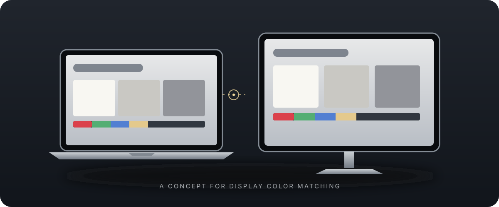

# Mac Color Match



**A small macOS utility for bringing an external display closer to the colors you prefer on your Mac.**

Mac Color Match lets you compare neutral patches side by side, tune an external display's software gamma curves, or estimate a gentle correction from one iPhone photo of both displays. It is designed for careful visual adjustment, with reversible previews and a clear reset path.

> The illustration above is conceptual. The app is a local calibration aid, not a colorimeter, a factory calibration tool, or a way to make two different panels identical.

## What it does

- Selects a connected display and adjusts its red, green, and blue transfer curves and midtones.
- Shows matching reference patterns on the Mac and external display.
- Analyzes a photo of both screens and offers a conservative, adjustable preview. The default photo correction starts at 25% strength.
- Automatically restores the previous gamma table when a preview is cancelled or expires, and provides explicit reset and recovery behavior.
- Keeps photos on the Mac; photo analysis does not upload them.

## Requirements

- Apple Silicon Mac
- macOS 13 or later
- Xcode Command Line Tools (`xcode-select --install`)

The app uses AppKit, SwiftUI, CoreGraphics, Vision, CoreImage, and ImageIO. It has no third-party runtime dependencies. Windows is not supported: display control and photo analysis currently use macOS frameworks.

## Build and run

```sh
zsh build.sh
open "Mac Color Match.app"
```

The build script creates an Apple Silicon app bundle and signs it locally with an ad-hoc signature. It is not Developer ID signed or notarized. macOS may require you to approve a locally built app in Privacy & Security. This repository does not include a pre-signed downloadable app.

## Quick start

1. Keep the Mac display in the state you want to use as your reference. For the original use case, True Tone stays on and Night Shift stays off.
2. On the external monitor, choose Standard or sRGB mode and turn off HDR, blue-light filtering, dynamic contrast, and game enhancements if available.
3. Open the comparison pattern. Adjust the monitor's own backlight brightness first; the app's brightness control dims output in software and does not change the backlight.
4. Use small RGB and midtone adjustments. For photo matching, display the app's photo pattern on both screens and take one unedited iPhone photo that includes all eight QR markers and every gray patch.
5. Start with the 25% photo preview. Lower its strength if the result looks too warm. Save only after checking the result by eye; cancel or let the preview expire to restore the previous state.

The detailed Korean guide is in [`사용법.md`](사용법.md). The recorded checks and known limits are in [`검증.md`](검증.md).

## Limits

- Photo-derived values are an estimate affected by camera exposure, white balance, viewing angle, glare, room lighting, and True Tone's current state.
- True Tone changes dynamically; the app does not follow or reproduce its sensor behavior.
- The app changes software gamma tables. It does not create or install an ICC profile and cannot expand a monitor's color gamut.
- The app has been exercised on one Apple Silicon Mac and one 1920×1080 external display. Other Mac models, macOS releases, display links, HDR paths, and monitor hardware need their own validation.
- This is a visual aid, not measurement-grade color calibration. Use a colorimeter and a suitable ICC workflow when accuracy matters.

## Project status

This is an experimental, single-user macOS utility shared as source. Contributions and issue reports are welcome, but compatibility claims should include the Mac model, macOS version, display connection, and steps used to reproduce the result.

## License

MIT. See [`LICENSE`](LICENSE).
